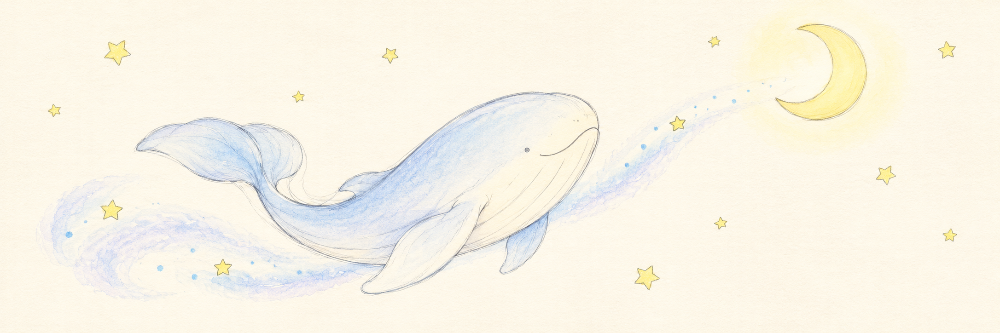

  

# KheMoos

**Khe is the whale. Moo is the moon.** Together, they form our Rust rendering and general physics engines for real-world simulation.

| [Khe · Rendering engine](https://github.com/KheMoos/Khe) | [Moo · General physics engine](https://github.com/KheMoos/Moo) |
| :---: | :---: |
|  |  |
| Rendering, materials, lighting, and scientific visualization. | Physical state, laws, materials, constraints, and solvers. |

Moo's intended scope includes rigid bodies, fluids, deformable solids, thermal systems, and their interactions. Khe makes those worlds visible through its rendering engine and interactive viewer.

**Bulk execution** is a core requirement: headless runs, reproducible configurations, validation, and measured performance.

Both engines are in early development. Physical accuracy, rendering fidelity, and throughput are goals demonstrated through tests and benchmarks as the engines mature.
